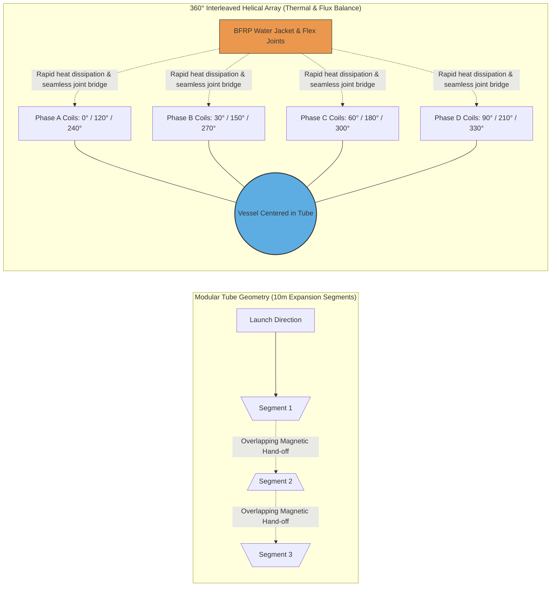

# 🌐 Project MagShot: Symmetrical Oblique Launch & Closed-Loop Planetary Infrastructure

This project introduces a high-logic, multi-tiered interplanetary transportation framework that optimizes environmental resources and leverages advanced electromagnetic physics. By eliminating chemical rocket propellants during initial launch phases, the architecture provides a scalable framework for cargo and human transit.

---

## 🛠️ 1. THE MAGSHOT LAUNCHPAD: Symmetrical Oblique Vacuum Rail

The terrestrial launch infrastructure utilizes an optimized, propellant-free vacuum tube assembly to break orbit without chemical fuel consumption, engineered as a multi-tier modular framework:

- **Initial Kinetic Injection (Mass-Based Stage-0 Launch):** To prevent catastrophic energy spikes and coil overheating during zero-velocity startup, the system utilizes a mass-calculated initial propulsion stage:
  1. *Dynamic Mass Calculation:* The launch system quantifies the exact structural mass of the vessel before firing, delivering a precise kinetic energy payload to the base of the rail.
  2. *Velocity Entry Threshold:* The initial stage injects the vessel into the primary tube at a calculated baseline speed. This ensures the spacecraft enters the 360° oblique magnetic zones with enough momentum to instantly synchronize with the linear acceleration fields.
  3. *Continuous Acceleration Efficiency:* By bypassing static friction and low-speed efficiency drops, the primary magnetic rails focus exclusively on delivering progressive, continuous velocity accumulation up to the 8,000 m/s orbital break target.
- **Liquid Immersion G-Protection:** Passengers are enclosed within a fluid-filled cabin substrate during launch. Utilizing Pascal's Principle, the hydrostatic pressure equalizes mechanical loads perfectly across the human body, rendering a high-velocity 8 G acceleration completely safe.
- **Oblique-Axis Zig-Zag Modules (10-Meter Sections):** The rail tunnel is constructed from independent 10-meter structural segments arranged in a micro-oblique zig-zag pattern. Suspended via magnetic centering arrays, these segments expand and contract freely under seasonal temperature fluctuations, eliminating long-axis structural buckling.
- **360° Accordion Magnetic Suspension & Cogging Eradication:** A dynamic, accordion-style repelling magnetic array wraps evenly around the full 360-degree circumference of the tube:
  1. *Radial Centering:* The complete circular distribution provides perfect multi-axis stability, preventing any rotational or lateral roll anomalies.
  2. *Skewed Magnetic Segments:* Acceleration magnets are angled slightly relative to the track coils, ensuring the magnetic flux shifts smoothly between nodes to eradicate structural cogging torque (mechanical ripple vibration).
- **Passive Atmospheric Clamping (Greased End-Plug):** The exit terminal is sealed with a grooved, heavily lubricated structural plug. The internal hard vacuum (0 Torr) utilizes ambient atmospheric pressure to passively force the plug tighter into the sealing seat. The plug is designed to sublimate or break apart upon contact with the leading penetrator cone at the exact millisecond of launch.
- **Shallow Launch Angle (Gradient Atmospheric Transition):** Instead of a vertical trajectory, the MagShot rail exits the water-jacket envelope at a shallow, oblique angle. This smooths out the aerodynamic transition by spreading atmospheric density shifts ($d\rho/dt$) linearly, preventing destructive Max-Q shocks and allowing the leading sacrificial ice shield to sublimate at a controlled, stable rate.
- **Five-Stage Aerodynamic Penetrator Array (Tandem Core):** To shield the central spacecraft from the raw intensity of atmospheric friction at 8,000 m/s, components travel in a linear multi-body configuration:
  1. *Solid Mass Air-Breaker (Tip):* Hurls forward first to part the primary atmospheric shockwave (Bow Shock).
  2. *Sacrificial Ice Shield:* Sublimates under compression heat, creating a dense cooling gas buffer.
  3. *Carbon Cone 2 (Fore Guide):* High-thermal carbon composite that blankets and laminates the remaining gas flow.
  4. *Spacecraft Core (Payload):* High-logic crew capsule traveling safely inside the created low-pressure vacuum pocket.
  5. *Carbon Cone 1 (Aft Guide):* Aerodynamic rear cone that closes the wake airflow softly, entirely eliminating base drag.
- **Thermally Conductive Dielectric Tube & Closed-Loop Basalt Water Jacket:** The 10-meter oblique zig-zag vacuum tubes are fabricated from thermally conductive, electrically insulating basalt composite (doped with Boron Nitride, SiC, or AlN fillers) and encased within a closed-loop Basalt Fiber Reinforced Polymer (BFRP) water jacket. This 100% corrosion-free assembly eliminates braking eddy currents, actively cools the acceleration coils, and harvests waste thermal energy.
- **Pre-Spun Electric Start & 3D-Skewed Magnetic Rifling:** Rotational spin-stabilization is initiated electrically at the launch terminal prior to injection (spinning only the outer structural shell on human-rated Class 2 capsules while the liquid-immersion core remains non-rotating). Short, 3D-contoured skewed magnets bridge the expansion joints between 10-meter tube segments into a seamless "invisible magnetic rifling," supported by joint position sensors, longitudinal recoil anchors, and regenerative energy-recovery capacitors.
- **Dual-End Carbon-Carbon (C/C) Thermal Cones:** High-temperature Carbon-Carbon composites are retained on both the fore and aft cones of the penetrator array to withstand extreme atmospheric entry friction at the nose and intense shockwave wake recompression heating at the tail.

---

## 📐 2. Track Classes & The Duplex Core Carousel

The infrastructure scales across three dedicated track configurations optimized for specific payloads and maintenance profiles:

- **Biological Necessity Resource Architecture:** The extensive water-jacket envelopes and liquid immersion systems are strictly isolated to human-rated passenger transit (Class 2). Hardened cargo and raw materials (Class 1) travel completely dry and unprotected, allowing the infrastructure to bypass massive fluid payloads and operate at maximum kinetic and energy efficiency when biological life support is not required.
- **Class 1: Cargo Vector (24 km Track):** Pure material and hardened electronics transit. High-intensity electromagnetic fields accelerate cargo at over 130 Gs, keeping the infrastructure footprints ultra-short and highly cost-effective.
- **Class 2: Passenger Vector (600 km Track):** Human-rated corridor equipped with full liquid-immersion cabins and closed-loop water-jacket cooling. The extended length smooths out the kinetic profile to a constant ~5.4 G acceleration, which registers as a comfortable, uniform hydrostatic pressure wrap due to the liquid immersion cabin.
- **Class 3: Main Line Carousel (Duplex Rump):** A massive transit hub housing two separate 360° zig-zag tubes inside a single outer vacuum sheath:
  1. *Zero-Downtime Swaps:* While Tube A actively launches outbound vessels, Tube B is locked into a downward maintenance berth.
  2. *Revolver Core Mechanism:* When Tube A requires cleaning or track lubrication, the internal cylinder mechanically rotates 180 degrees like a revolver cylinder, bringing the pristine Tube B online in milliseconds without halting scheduling.

## 🔄 Phased Economic Loop & Passive Helium-3 Return System

To eliminate massive upfront capital barriers, Project MagShot scales in two financially self-sustaining phases, closing the Earth–Moon logistics loop without parachutes or retro-rockets:

1. **Phase 1 — 24 km Cargo Vector (High-G Industrial Launch):** The initial 24 km electromagnetic rail launches ruggedized mining, ISRU, and orbital infrastructure payloads at high G-loads. Because no human life-support systems are required, construction costs remain a fraction of a human-rated system.
2. **Phase 2 — Lunar Helium-3 Revenue Funding the 600 km Passenger Line:** Automated lunar operations (such as *Project Lunar-Cradle*) harvest Helium-3 and rare resources, returning compact, high-value cargo capsules to Earth. The commercial energy revenue from Helium-3 directly finances the expansion into the low-G **600 km Class 2 Passenger Vector**.

### 💧 Aerodynamic Teardrop Return Capsule (Low-Mass Cargo)
Because the return payload consists solely of compact, lightweight Helium-3 tanks rather than heavy crew cabins, total kinetic entry energy ($E_k = \frac{1}{2}mv^2$) is minimal and structural G-tolerance is high:
- **Forward-Weighted Teardrop Geometry:** The center of mass is positioned directly behind a **Carbon-Carbon (C/C) nose cone**, paired with small aft control fins. This creates passive aerodynamic stability during atmospheric re-entry, keeping the C/C heat shield locked into the airflow without active thrusters.
- **Dual-Layer Thermal Foam & Monolithic Inner Seal:** Beneath the C/C nose sits a two-stage insulation barrier: an outer **high-temperature ceramic/carbon foam** that blocks re-entry heat conduction, and an inner **cryogenic foam layer** bonded with a continuous internal vapor seal to prevent Helium-3 boil-off or leakage.

### 🌊 Bubble-Aerated Algae Deceleration Basin (Zero-Parachute Splashdown)
Instead of single-use parachutes or ocean recovery fleets, capsules enter a dedicated artificial deceleration reservoir at a shallow glide angle:
- **Aerated Algae Cushioning Layer:** Near-surface floating algae colonies continuously oxygenate and micro-bubble the upper water column. By lowering the effective fluid density and increasing compressibility, this aerated layer eliminates the violent "surface slam" upon water entry.
- **Tapering Channel & Porous Concrete Wave Damping:** As the capsule skims into a narrowing, funnel-shaped water corridor, progressive hydrodynamic drag brings it to a smooth halt. High, **porous concrete retaining walls** line the channel to absorb splash energy and dissipate wake waves without destructive reflections—allowing rapid, automated capsule retrieval and reuse.
- **Freshwater Zero-Corrosion Turnaround:** Unlike ocean splashdowns—where hot spacecraft hulls suffer severe saltwater chloride corrosion, conductive salt-spray shorts, and baked-on mineral fouling in seams and magnetic actuators—a closed freshwater reservoir eliminates salt-induced degradation entirely, enabling rapid, low-cost vehicle refurbishment and relaunch.

### 🛡️ Human-Rated Splashdown Protection (Class 2 Passenger Variant)
When scaling water landings from compact cargo capsules to larger human-rated **Class 2 Passenger Vehicles**, ventral thermal shock, steam-flash discharges, and hydrodynamic suction (Coandă effect) at water contact are eliminated through three integrated safeguards:
- **Orbital Vacuum-Foamed Crush Shield:** Prior to de-orbiting, orbital nozzles extrude a pre-ceramic polymer or lunar-derived aluminum-silicate resin across the vessel's ventral hull. Exposure to the vacuum of space naturally foams the matrix into a closed-cell structural sponge cured via solar UV or induction heating. During atmospheric re-entry, the outer cells ablate to keep the hull cool; upon water impact, the remaining porous foam acts as a sacrificial mechanical crush zone that absorbs hydrodynamic shock and prevents violent steam-flash discharges.
- **Stepped Ventral Hull (Anti-Suction Chine):** A sharp hydrodynamic step along the lower hull breaks surface-tension suction at high horizontal skim speeds, entraining air beneath the aft section to prevent nose-diving or tail-slamming.
- **Two-Stage Aerated Deceleration Corridor:** Combined with the crew's internal **liquid-immersion G-cabins**, the entry zone of the artificial basin uses dense subsurface micro-bubble injection alongside floating algae to cut initial water density nearly in half—transitioning smoothly into denser, un-aerated water further down the tapering channel for a gentle < 3 G stop.

---

## 📄 License

This project is licensed under the **MIT License** – preserving the original architecture credited to the creator.

Copyright (c) 2026 masakertsa
